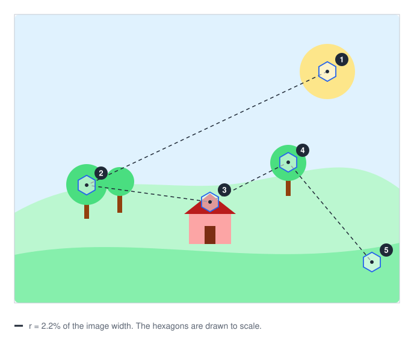
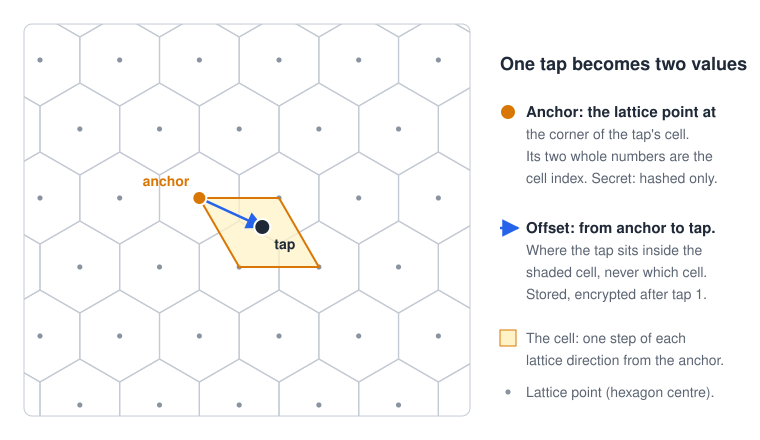
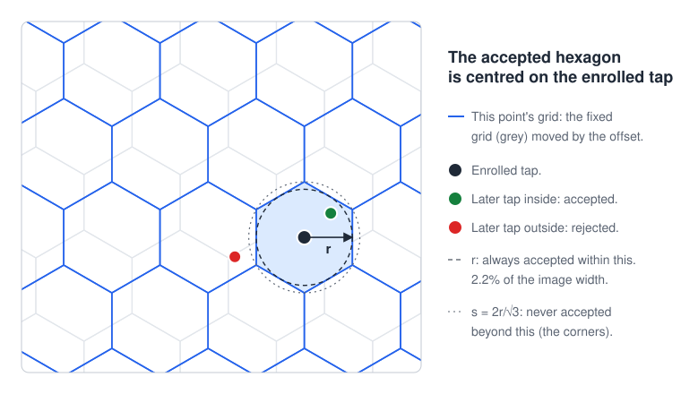
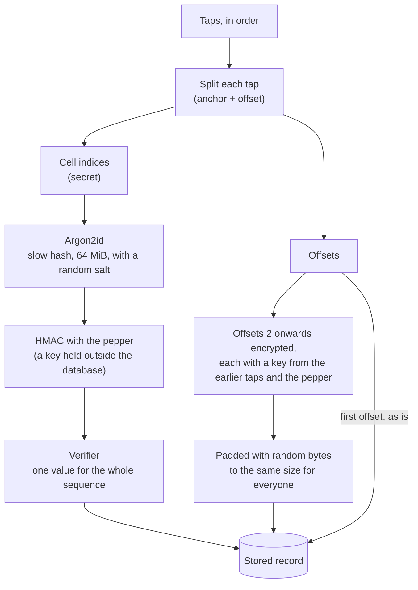
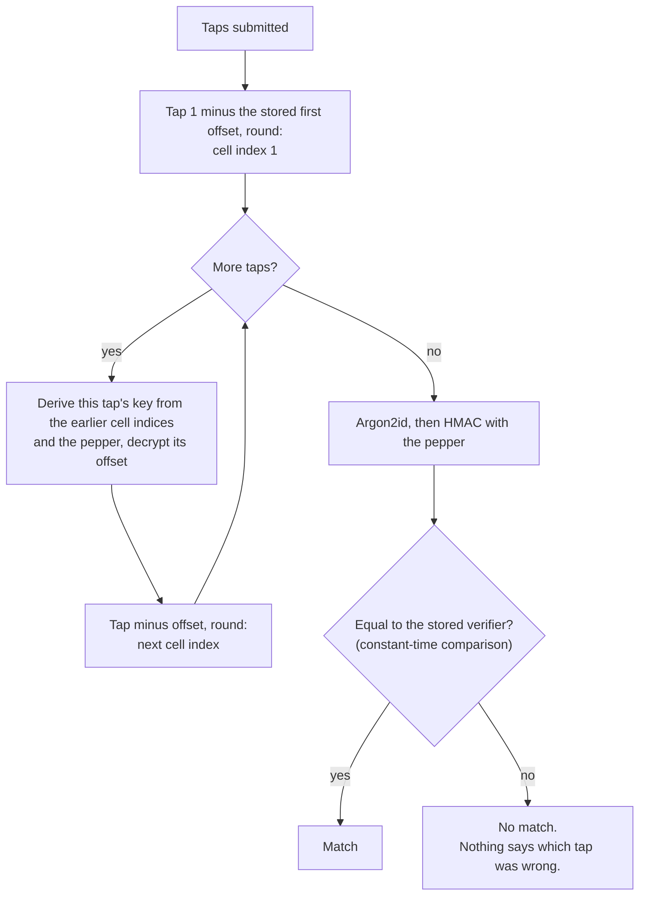
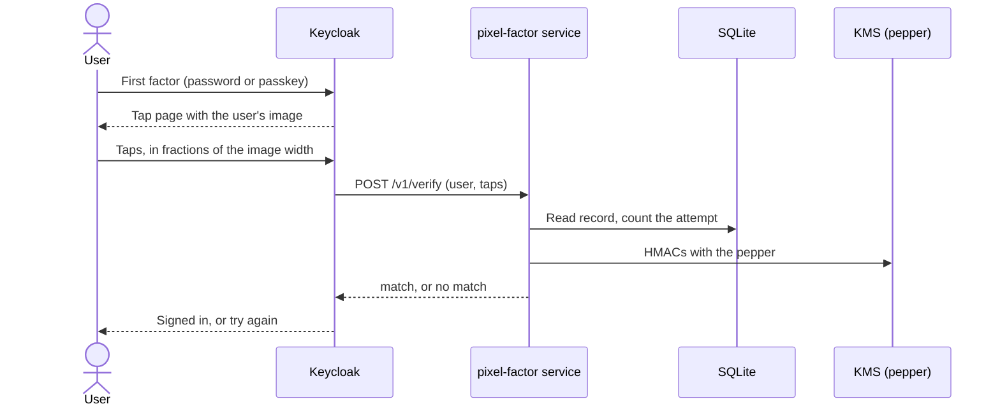

# How pixel-factor works

A plain-language tour of the design, with pictures. It assumes no cryptography. For the precise rules, see [spec.md](spec.md); for every byte, see [core-format.md](core-format.md).

## The idea

Instead of typing a password, you tap a few points on a picture, in an order only you know. Next time you sign in, you tap the same points in the same order. You do not have to hit them exactly: each tap counts if it lands close enough to where you tapped when you set it up.

The default is five taps, plus an optional sixth that returns to an earlier point. Each small hexagon above is how close a later tap has to be. It is drawn to scale: about 4% of the image width across, which is comfortable on a desktop and needs a pinch of zoom on a phone.

Two things make this hard to do safely:

1. **Fuzziness.** A password is checked by hashing it and comparing the hash. But a hash only matches if the input is identical, and taps never are.
2. **A small secret.** Five points on an image give about 44 bits in theory, and fewer in practice, because people favour the same eye-catching spots. A stolen database must not let anyone try every combination offline.

The rest of this page explains how the design deals with each.

## Turning a fuzzy tap into an exact value

Picture a grid of hexagons laid over the image. If every tap were replaced by "which hexagon it is in", two nearby taps would give the same answer, and that answer could be hashed like a password.

On its own that fails at the edges: a tap near the border of a hexagon might land in the neighbouring one next time. The fix, known as *centred discretisation*, is to move the grid for each point so that the tap sits at the dead centre of a hexagon.

### Step 1: split each tap into an anchor and an offset

There is one fixed lattice of points, the hexagon centres. At enrolment, each tap is split in two:

- The **anchor** is the lattice point at the corner of the cell the tap falls in. It is written as two whole numbers, the **cell index**. This is the secret part. It is only ever hashed, never stored.
- The **offset** is the step from the anchor to the tap. It says where the tap sits inside its cell, but not which cell. It is stored, so it can be used at the next sign-in.

### Step 2: at sign-in, undo the offset and round

When you tap again, the stored offset is subtracted from your new tap and the result is rounded to the nearest lattice point. That is the same as moving the whole grid by the offset, so this point gets its own grid in which your original tap is exactly at a hexagon's centre:

Any later tap inside the shaded hexagon rounds back to the same anchor, so it produces the same cell index. A tap outside rounds to a different one.

- Within **r**, 2.2% of the image width, a tap is always accepted, in every direction.
- Beyond **s** (about 2.5% of the width, the hexagon's corners) it is never accepted.

Every point has its own shift, so the hexagons of different points do not line up with each other. Coordinates are fractions of the image width, never pixels, so the same record works on any screen.

## What is stored, and why a stolen copy is not enough

Enrolment turns the taps into a record. Nothing in it reveals where the points are.

The design rests on four choices:

- **One hash for the whole sequence.** There is never a hash per tap, so a wrong attempt cannot reveal which tap was wrong. It is all or nothing.
- **A pepper.** Besides the usual random salt, the final hash is keyed with a secret held in a key management service (KMS), not in the database. Someone who steals the database cannot check a single guess without it. That is what protects a secret as small as this one. Argon2id, the slow hash, is a second line of defence in case the pepper is lost too.
- **Chained offset encryption.** The offset of tap 2 is encrypted with a key that depends on the cell index of tap 1, tap 3's on taps 1 and 2, and so on. Without the pepper and the right earlier taps, the offsets read as noise. There is deliberately no integrity check: a wrong key gives a plausible offset rather than an error, so nobody can test one tap at a time.
- **No tap count.** Every record has the same 31 offset slots, filled with random bytes after the last real one, so a stolen record does not show how many taps a user chose.

## Signing in

If an early tap is wrong, every key after it is wrong too, so the later offsets decrypt to rubbish and the result cannot match. The final answer is the only signal.

## Guessing at the sign-in page

The pepper stops offline guessing. Online guessing, by trying taps at the real sign-in page, is limited by a lockout in the service:

- After 5 wrong attempts the account is locked for a minute, then 2, 4 and so on, up to an hour. That allows about 30 guesses a day, far fewer than the number of possible sequences.
- Unknown usernames are counted and answered exactly like real ones, so an attacker cannot use the lockout or the timing to learn which accounts exist.
- Throttling a single noisy source (one address making many requests) belongs in Keycloak and at the network edge, which see the user's address. The service only sees Keycloak.

A lockout can also be abused to keep someone *out*: anyone who knows a username could send one wrong attempt an hour. That is why the tap step must come after another factor, such as a password or passkey. A stranger who has not passed that factor cannot reach the tap step at all. See [THREAT-MODEL.md](THREAT-MODEL.md).

## How the pieces fit

- **Keycloak** is the sign-in system. A small plugin shows the tap page and calls the service. It holds no secrets and does no cryptography. The plugin is planned, not built yet.
- **The service** ([service.md](service.md)) owns the records and the lockout, and runs the core library. It is meant for an internal network, reachable only by Keycloak.
- **The core library** does the geometry, hashing and encryption, with no input or output of its own.
- **The KMS** holds the pepper and performs the HMAC itself, so the key never leaves it. This is not built yet: development uses an in-memory stand-in, which is why nothing here should protect real accounts.

## What this does not do

- It is a knowledge factor, like a password. Pair it with a possession factor such as a passkey; do not use it alone.
- Nothing can recover a forgotten sequence. A reset means proving who you are another way and enrolling again.
- It has not been independently reviewed. See [the review request](../README.md#cryptographic-review-wanted).

## About the pictures

The hexagon diagrams are drawn by `docs/images/make_diagrams.py` (Python standard library only). After changing it, run `python3 docs/images/make_diagrams.py` from the repository root and commit the regenerated SVG files. The flowcharts are Mermaid, which GitHub renders directly.
